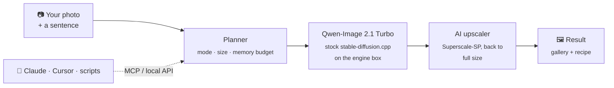
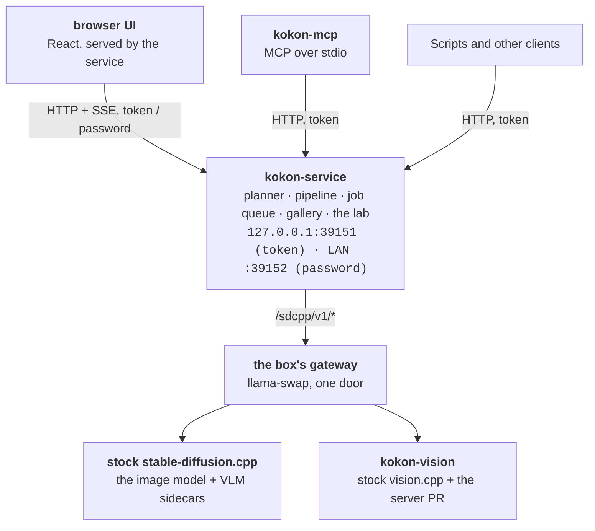

<p align="center">
  <picture>
    <source media="(prefers-color-scheme: dark)" srcset="assets/brand/wordmark/kokon-ee-wordmark-white.svg">
    
  </picture>
</p>

<h3 align="center">Edit photos by describing the change — on your box, through your gateway, on stock engines.</h3>

<p align="center">
  Kokon EE is the Kokon service unbundled from its bundled engine: a Docker image with the
  browser UI and the MCP server, pointed at your box's gateway, which schedules the stock
  inference engines — stable-diffusion.cpp for the image models, llama.cpp for the
  prompt-enhancer sidecars. The service holds the entrypoints, the API keys and the prompts;
  the engines stay stock upstream. Your photos stay with you, and you can edit as often as
  you like.
</p>

<p align="center">
  <a href="docs/fresh-box.md"></a>
  <a href="#use-it-from-your-ai-agent"></a>
  <a href="LICENSE"></a>
</p>

<p align="center">
  <a href="docs/fresh-box.md">Run it on a box</a> ·
  <a href="#derived-from-kokon">Derived from Kokon</a> ·
  <a href="#what-you-can-do">Features</a> ·
  <a href="#how-it-works">How it works</a> ·
  <a href="#use-it-from-your-ai-agent">AI agents</a> ·
  <a href="#faq">FAQ</a>
</p>

---

## Derived from Kokon

Kokon EE is a derivative of [Kokon](https://github.com/GabrieleLozupone/kokon) by
[Gabriele Lozupone](https://github.com/GabrieleLozupone), AGPL-3.0-only. This repository's
history is Kokon's history, un-rewritten: every derived commit keeps its original author and
date, and [NOTICE](NOTICE) carries his copyright for the derived parts alongside ours for the
parts this project adds.

The external-engine mode was proposed to the author in
[Discussion #52](https://github.com/GabrieleLozupone/kokon/discussions/52) (2026-11-06). He
keeps Kokon's one-model vision, and this line of work carries on here as a standalone
project. What this project changes:

- **The engines are external and stock.** The service ships no engine build: it points at
  entrypoints, API keys and prompts, and the box's gateway (llama-swap) schedules the stock
  engines — stable-diffusion.cpp for the image models, llama.cpp for the sidecars.
- **The prompt enhancer is a sidecar.** Prompt+ runs as a named model on the gateway, not as
  a text-generation fork of the engine.
- **Multi-user mode.** Named accounts with per-user galleries and projects on the same
  service (a config gate, off by default).
- **The product is the box service.** Docker image + browser UI + MCP, one compose file, no
  installer and no desktop app. The desktop-app parts are being retired in this repository.

**How you get it.** There are no tagged releases and no installer: the service image is the
product. Clone this repository, `docker build -f docker/Dockerfile`, `docker compose up -d`.
The whole stack on a new machine — the gateway and its model list, the engines, the service —
is [docs/fresh-box.md](docs/fresh-box.md).

> The sections below document the inherited Kokon product — its features, engine and FAQ —
> which is what the service underneath still is.

---

## New in 0.12: split any image into layers

<p align="center">
  <a href="https://youtu.be/eGr9yYe7NVc"></a>
</p>

- **Split**: the lab (experimental) separates the objects in a photo into layers — each one
  movable, scalable, editable — with the background behind it, so you can move, scale, hide or
  edit any piece, expand one that was cut off by the frame, and save one image or **export a
  PSD** for Photoshop, GMP or Photopea. It runs on the box, never in your browser.
- **Blend into scene** (experimental): after a move, Kokon redraws the shadows, or reflections
  on wet or shiny ground.
- **Paint with colours**: one colour per thing, and say what goes there, right on the picture;
  **Select** picks an object with one click.
- **Prompt+ for painted areas and Expand**, with a Standard or Detailed level.
- **AI marking**: every image says, in its file and in an invisible watermark, that it was made
  with AI ([docs/ai-marking.md](docs/ai-marking.md)).

---

## Since 0.11: use it from your phone, or run it as a server

<p align="center">
  <a href="https://kokon.app/self-hosted/"></a>
</p>

The computer with the graphics card makes the images; your phone, tablet or laptop uses Kokon
in a browser. Nothing goes through a cloud, and there is no account.

- **Other devices:** open **Settings → Other devices** (in the browser UI: the people/settings
  area), set a password and scan the QR code with your phone. The browser is a full client:
  everything the interface does works there.
- **The box:** the service runs headless (Docker image or bare binary) and serves the same
  interface on its LAN port. This fork's product *is* this shape:

  ```bash
  docker compose up -d
  docker exec -it kokon kokon-service --set-password
  ```

  Step by step: [docs/fresh-box.md](docs/fresh-box.md) (the whole stack),
  [docs/service-on-prod-box.md](docs/service-on-prod-box.md) (the split box),
  [docs/remote-access.md](docs/remote-access.md) and [docs/docker.md](docs/docker.md).

---

## A local alternative to Nano Banana, without the node graph

Cloud editors made "edit a photo with a sentence" normal, but they upload your photos and limit
how much you can make. Kokon is the same idea, run on your own box:

<table align="center">
  <tr>
    <td width="33%" valign="top">
      <h3>🔒 Private by design</h3>
      Your photos never leave your network. The models run on your own hardware through your
      box's gateway; nothing is sent to any cloud. A private mode keeps nothing at all.
    </td>
    <td width="33%" valign="top">
      <h3>🎯 Nothing to tune</h3>
      We pick the model and every setting: the size that fits your card, the memory budget,
      the schedule. You describe the change; the box does the rest.
    </td>
    <td width="33%" valign="top">
      <h3>📦 One image</h3>
      A Docker image with the browser UI and the MCP server, pointed at your box's gateway.
      No Python, no ComfyUI, no node graphs. The engines stay stock upstream.
    </td>
  </tr>
</table>

## Why Kokon

| | **Kokon EE** | ComfyUI + Qwen workflow | Krita AI Diffusion | Other Qwen web UIs |
| --- | :---: | :---: | :---: | :---: |
| Setup | one image + a gateway | Python environment + nodes | Krita + plugin + ComfyUI | Python or ComfyUI |
| Picks size and memory settings for you | ✅ | ❌ | partly | partly |
| Brush edits the model can see | ✅ | depends on the workflow | ✅ | rarely |
| MCP server for AI agents | ✅ | community nodes | ❌ | ❌ |
| Custom pipelines, node graphs | ❌ | ✅ | partly | ❌ |

## Examples

<p align="center">
  
  <br>
  <sub>One project, six steps in Kokon: generate the Colosseum, rebuild it out of pasta,
  add a tomato sauce river, generate the kitchen, combine the two, expand to 21:9.</sub>
</p>

Every image below was made by Kokon itself (no stock photos), first try with that seed.

| | |
| :---: | :---: |
| <br>**Remove** · paint the scooter · *“the red scooter”* | <br>**Replace** · *“Replace the yellow armchair with a deep green velvet sofa and hang an abstract painting above it”* |
| <br>**Relight** · *“Make it a snowy winter night, warm light glowing from the cabin windows”* | <br>**Restyle** · *“Turn it into a hand-painted watercolor illustration”* |
| <br>**Text** · *“Change the gold sign text to ‘KOKON CAFÉ’”* | <br>**Expand** · 40 % left and right · *“continue the rocky coastline and the turquoise sea”* |

## Run it

**On a fresh machine** — the whole stack (gateway, engines, models, this service):
[docs/fresh-box.md](docs/fresh-box.md). **On a split box** — the service and the browser UI on
one machine, all inference on the accelerator box through its one-door gateway:
[docs/service-on-prod-box.md](docs/service-on-prod-box.md).

In short:

```bash
# the published image (the repo's CI pushes it to ghcr on every push to main;
# the package is public — no login, no build step):
docker pull ghcr.io/iamskeole/kokon-ee:latest

docker compose up -d
docker exec -it kokon-ee kokon-service --set-password   # once
```

Open `http://<the box>:39152`, sign in, and edit.

### Requirements

The service box is light (a few hundred MB of RAM); the hardware that matters is the
**engine box**:

| | Minimum | Recommended |
| --- | --- | --- |
| **GPU** | 12 GB VRAM (RTX 3060 12 GB, 4070); 8 GB works in beta | 16 GB+ (RTX 4080, 5070 Ti, 5080, 4090, 5090) |
| **Driver** | the proprietary NVIDIA driver (CUDA) | |
| **RAM** | 16 GB | 32 GB |
| **Disk** | ~15 GB for the models | 25 GB on an SSD |
| **Time per image** | RTX 5070 12 GB: ~12 s per 1 MP image, ~42 s at native 2K (text to image) | RTX 5070 Ti 16 GB: ~24 s per edit at Balanced (1.5K), ~36 s for a new image at native 2K |

The gateway and its engines need nothing else; the service image is small (the UI is embedded).

### What runs where

- **The service box**: this image — the browser UI, the API, the job queue, the gallery, and
  the lab's two models (MobileSAM, BiRefNet-lite; in-process, or through the `kokon-vision`
  door on the gateway).
- **The engine box**: the stock engines behind the gateway — stable-diffusion.cpp for
  Qwen-Image 2.1 Turbo (the image model, Q4_K_M GGUF, ~4.2 GB) and its Qwen3-VL text encoder
  (Prompt+), llama.cpp for the prompt-enhancer sidecars, vision.cpp for the lab door. The
  ml repo pins the exact files and builds.
- **Your devices**: any browser; the MCP server for your AI agents.

## What you can do

| You give Kokon | It does | |
| --- | --- | --- |
| A sentence | **Create** a new image | Aspect ratio from the prompt or the aspect menu |
| A photo + a sentence | **Edit** it | Original size and aspect ratio are kept |
| Several photos + a sentence | **Combine** them | Refer to them as “image 1”, “image 2”… and drag to reorder |
| A brushed area + an action | **Inpaint**: Change, Remove, Replace or Add | Remove needs no prompt |
| Dragged edges | **Expand** the photo (outpainting) | Or type pixel or percent values |
| Clicks on the objects | **Split it into layers** (Layers lab, experimental) | The background is filled behind them; move, edit, export a PSD |
| Areas painted in colours + what goes there | **Several changes in one go** | Only what you painted changes |
| Any result | **Upscale** to 2×, 4K, the source size or a custom width | With the upscaler model, in seconds |
| Any result | **Colour-grade** it with a LUT | Eight built-in looks (Neutral takes out a yellow cast) or your own `.cube` files, live preview with intensity |
| A short idea, in any language | **Prompt+** writes the detailed prompt first | You watch it being written; for edits it looks at your photo. A sidecar on the gateway: a few seconds more |
| Your own LoRA files | **Apply them** to a project (beta) | Qwen-Image 2.1 LoRAs (`.safetensors`) loaded in Settings → LoRA, up to 3 at once, each with its strength |

**New to prompts?** The [prompt guide](docs/prompting.md) shows good and bad prompts side by
side; [docs/showcase-prompts.md](docs/showcase-prompts.md) has the recipes for the showcase
images.

<p align="center">
  
</p>

Every result can be edited again, varied, used as a reference, upscaled, saved or copied. A
few things make that loop fast:

- **Before/after**: compare with Slider, Flicker or Changes, or hold <kbd>B</kbd> to see the original.
- **Undo/redo between versions** with <kbd>Ctrl</kbd>+<kbd>Z</kbd> / <kbd>Ctrl</kbd>+<kbd>Y</kbd>.
  Undo returns to the version the current one came from, and nothing is ever deleted.
- **Gallery**: every image keeps its full recipe (prompt, seed, settings, pipeline) and reopens
  with one click. The recipe is also embedded in the PNG.
- **Quality presets**: **Fast** (the default, ~1 MP), **Balanced** (~1.5K) and **Quality**
  (native 2K, or 16 MP on the models that run that large). Each runs the selected model's
  own recipe, so you never need to tune steps or guidance.
- **The model is a small list**: Qwen-Image 2.1 Turbo (the default), Qwen-Image 2.1, Flux
  Image 3 Klein and MiniMax H3 Image — switchable where the box's config names a picker.
  The default never changes behind your back; a new model joins as a pick, not a swap.

## How it works



The planner decides what kind of job your request is, picks a working size that fits the
engine box's card and runs a single diffusion pass. When the result has to be larger than
what the model rendered, it is enlarged with an AI upscaler instead of a plain resize. For
brushed edits, Kokon marks the area on a second reference image so the model knows exactly
where to work. Without that, Qwen-Image 2.1 cannot see the mask.

With **Prompt+** on, the planner first asks a Qwen3-VL sidecar on the gateway to write a
detailed English prompt, looking at your photo for edits. The image then uses that prompt,
and the result keeps both yours and the written one.

### The engine

The image model runs on **stock**
[stable-diffusion.cpp](https://github.com/leejet/stable-diffusion.cpp) (leejet), loaded by the
box's gateway — no fork of the engine in this project. The parts the product needs from
outside the engine are separate stock engines on the same gateway:

- **Prompt+** is a llama.cpp sidecar (a Qwen3-VL GGUF) behind the gateway, named per pipeline
  in the config, with its prompt bundle in the service's data folder.
- **The lab** (MobileSAM, BiRefNet-lite) is stock vision.cpp with the upstream
  [`vision-server` PR](https://github.com/Acly/vision.cpp/pull/25) as the `kokon-vision` door,
  or runs in-process on the service box when the door is absent.
- **Upscalers** live with the engine, in its own models folder; the engine's capabilities
  report them.

The engine's request schema is the only thing the service knows about engines
(`crates/qls-core/src/sdcpp.rs`), and it is stock. Module map and the measured facts:
[docs/engineering-notes.md](docs/engineering-notes.md).

## Use it from your AI agent

Kokon ships an [MCP](https://modelcontextprotocol.io) server (`mcp/`): a small TypeScript
program that talks to the service over its local API. Point your agent at it:

```json
{
  "mcpServers": {
    "kokon": {
      "command": "node",
      "args": ["path/to/kokon-ee/mcp/build/index.js"],
      "env": { "QLS_DATA_DIR": "/data" }
    }
  }
}
```

(Or the published package, where available.) Then ask: *“Generate a hero image for this README
and save it in docs/”* or *“Remove the background clutter from screenshot.png”*. On the box
the engines load through the gateway on the first call; the first call of a session takes as
long as the engine boot.

**Tools:** `generate_image` · `edit_image` · `edit_images` · `inpaint_image` · `outpaint_image`
· `upscale_image` · `get_image_info` · `get_generator_status`

<details>
<summary><b>MCP behavior and safety</b></summary>
<br>

- Every result returns the path of the saved file, its size, seed and generation metadata.
- Paths may be absolute or relative to the project (`CLAUDE_PROJECT_DIR`). Reads and writes
  are limited to the project folder, the service's output folder and folders listed in
  `QLS_MCP_ALLOWED_DIRS`. Existing files are never overwritten.
- Images are **not** sent back to the model by default; they stay on disk. Pass
  `include_preview: true` to include a small JPEG preview.
- `upscale_image` takes `scale` (default 2) or `width`/`height` (up to 8192 px).
- Progress is reported through MCP progress notifications. The gateway's TTL is the authority
  on the engine's lifetime; Kokon never unloads an engine it does not own.

</details>

<details>
<summary><b>Local HTTP API</b></summary>
<br>

Base URL `http://127.0.0.1:39151/api/v1`. Every call except `/ping` needs
`Authorization: Bearer <token>`, with the token from the service's `service.json` (on the
box: `/config/service.json`). The full route list is in
[docs/http-api.md](docs/http-api.md).

</details>

## Privacy

The service makes only two kinds of network request:

- **Downloads:** the lab models, the watermark models and (on a single box) the upscalers,
  from their authors' hosts (`huggingface.co`, GitHub, Adobe's watermark host), pinned by
  size and SHA-256.
- **The gateway:** every inference call goes to the box's gateway (a host service), never to
  a cloud.

Creating, editing, the gallery, the MCP server and the API talk to the box only, and to your
devices over your network when you turn on LAN access (password required). Logs never
contain your prompts.

**Private mode** (the eye icon in the top bar) keeps images and prompts out of the gallery,
the output folder and the project list. They are deleted when you turn private mode off or
when the service stops. **Save as…** still writes a copy wherever you choose.

## Where your files are

On the box image:

| What | Where |
| --- | --- |
| Settings (`config.json`, `service.json`) | `/config` (the compose's `config/` bind) |
| Gallery database, inputs, thumbnails, logs, lab models | `/data` (the compose's `data/` bind) |
| Saved images | `/gallery` (the compose's `gallery/` bind) |
| The image model and the upscalers | on the engine box (the ml repo's model home) |

Running the bare binary on your machine: the same folders under `~/.local/share/kokon-ee/`
(override with `QLS_CONFIG_DIR` / `QLS_DATA_DIR`).

## FAQ

<details>
<summary><b>Does it work on AMD or Intel GPUs?</b></summary>
<br>

The engine box decides. The gateway runs whatever stock engine build it has: CUDA for NVIDIA,
Vulkan for AMD and Intel. The service itself does not care — it only talks to the gateway.
On the original product's Vulkan builds, an RX 9060 XT 16 GB made a 1080p image at Balanced in
about 80 s (first image, model loading included).

</details>

<details>
<summary><b>My GPU has 8 GB. Can I still use it?</b></summary>
<br>

Yes, in beta. The planner picks smaller working sizes for 8 GB cards, so images are made at
about 1 megapixel (then enlarged). The text encoder runs from system RAM, so 16 GB of RAM or
more is recommended.

</details>

<details>
<summary><b>Can I use Kokon commercially?</b></summary>
<br>

Not with the default model. Kokon EE's code is open source (see [License](#license)), but the
image model has its own license: Qwen-Image 2.1 and its Turbo model are released under the
[Qwen Research License](https://huggingface.co/Qwen/Qwen-Image-2.1/blob/main/LICENSE), which
allows **research and evaluation only, no commercial use**. That includes selling or using
commercially the images you make with it. For commercial use, ask the Qwen team for a
license.

The Qwen3-VL text encoder is Apache-2.0. The default upscaler, Superscale-SP by Nmkd, is
WTFPL, and the experimental MoSR by Philip Hofmann is CC BY 4.0: both allow commercial use.
The optional UltraSharp upscaler is CC BY-NC-SA 4.0, non-commercial only.

</details>

<details>
<summary><b>iPhone photos (HEIC) and HDR</b></summary>
<br>

HEIC/HEIF photos open like any other image (the service needs `libheif` for them on Linux).
iPhone photos with an HDR gain map (iOS 18+) show a **Keep HDR** switch in Advanced, which is
on by default. Edits of such photos are saved as **Ultra HDR JPEG**; this needs `ffmpeg` 7.1+
on the service box's PATH; without it the result is saved in SDR and the job's notes say why.

</details>

<details>
<summary><b>Which upscaler is used, and can I change it?</b></summary>
<br>

By default **Superscale-SP** by Nmkd (ESRGAN), on the engine box. Pick another in the
Advanced menu next to the prompt, or in Settings: **Compare upscalers** shows each one on the
same crops.

- **Superscale-SP** (default): sharp and natural on most images; on JPEG photos and dark
  areas it can draw a faint grid.
- **MoSR** (experimental, 17 MB): the fastest, good for 4× upscales, but on clean images
  enlarged less than about 3× it draws a fine grid. Kokon contributed it to
  [stable-diffusion.cpp](https://github.com/leejet/stable-diffusion.cpp) (pull request
  #2128, merged 2026-10-12), so every stock engine since that release carries it.
- **UltraSharp** (optional download): very clean, but smooths skin into an artificial look
  and can invent lines. Non-commercial license.
- **Lanczos**: a plain resize, never invents anything.

**Upscaler strength** (0–100 %) mixes the upscaler's result with a plain resize. Settings
also has **Shrink the image before upscaling**, which gives the upscaler a smaller image,
like the ones it was trained on.

</details>

<details>
<summary><b>Something went wrong</b></summary>
<br>

The service's **Settings → Diagnostics** prints the box's health — the engine door, its
capabilities, the lab models, the watermark — and a copy button for it. If a download fails,
the report shows the file's download page and target folder so you can fetch it by hand.
Engine failures live in the gateway's log, not the service's. For anything else, please
[open an issue](https://github.com/GabrieleLozupone/kokon/issues/new) with your GPU, driver
version and the diagnostics report.

</details>

## Roadmap

- [x] The box service: browser UI, MCP, the job queue and the gallery
- [x] The engine as a stock upstream build behind the box's gateway (no forked engine)
- [x] The lab on the box: MobileSAM and BiRefNet-lite through the `kokon-vision` door
  (stock vision.cpp + the upstream server PR) or in-process — never in the browser
- [x] Multi-user mode: named accounts with per-user galleries
- [x] The chaff cut: no desktop app, no bundled engine, no in-app updater, no release
  machinery — the image is the product
- [ ] The vision.cpp server PR merged upstream (until then the fork's pinned build carries
  it)
- [ ] Batch edits: one instruction for a whole folder
- [ ] Background removal and transparent cutouts

What is in progress right now: [tracker/STATUS.md](tracker/STATUS.md).

## Build from source

<details>
<summary><b>Requirements and commands</b></summary>
<br>

Rust (stable) and Node 22+.

```bash
npm install
cargo test -p qls-core            # core unit tests
npx vitest run                    # UI logic tests
cd mcp; npx vitest run; cd ..     # MCP tests

npm run build                     # the UI (embedded into the service)
cargo build -p qls-service        # the service
docker build -f docker/Dockerfile -t kokon-service .   # the product
```

</details>

<details>
<summary><b>Architecture</b></summary>
<br>



The Rust core (`crates/qls-core`) holds all the logic: geometry, image processing, planning,
the engine door, the job queue, the lab and the gallery. The service, the browser UI and the
MCP server are thin layers on top. See the [engineering notes](docs/engineering-notes.md) for
a module map and the backend facts each default is based on.

</details>

## Upstream

Kokon is a one-person project by Gabriele Lozupone; this repository carries the
external-engine line of it, with the attribution in [NOTICE](NOTICE) and in the git history.
The upstream project, its site and its commercial licensing remain his — see
[github.com/GabrieleLozupone/kokon](https://github.com/GabrieleLozupone/kokon).

## Contributing

Bug reports, example prompts and pull requests are welcome. Run the tests (`cargo test
-p qls-core`, `npm test`, `cd mcp && npm test`) before opening a pull request;
[CONTRIBUTING.md](CONTRIBUTING.md) has the build and the code conventions.

## Responsible use

Kokon edits real photos. Don't use it to deceive, harass or impersonate people, or to make
images of someone without their consent. You are responsible for what you create and share.

Every image Kokon makes or changes with AI is marked as such, as the EU AI Act asks: in the
file's metadata (IPTC Digital Source Type) and with an invisible watermark
([TrustMark](https://github.com/adobe/trustmark), the text `Kokon-AI`) that survives JPEG,
resizing and screenshots. Please don't remove these marks. If you publish a realistic image
of real people, places or events, say that it was made or changed with AI. Settings →
Diagnostics can check any image's marks; [docs/ai-marking.md](docs/ai-marking.md) has the
details.

## License

Kokon EE's source code is released under the [GNU Affero General Public License
v3.0](LICENSE) (AGPL-3.0-only). The code is a derivative of
[Kokon](https://github.com/GabrieleLozupone/kokon): the license obligations of the original
apply to the derived parts and to this project as a whole — AGPL is copyleft, so a
derivative stays AGPL. Copyrights are recorded in [NOTICE](NOTICE): Gabriele Lozupone for
the parts derived from Kokon, iamskeole for the parts this project adds. The license covers
the code, not the images you make with it.

Model weights and the upscalers are downloaded from their authors and keep their own
licenses (see the [FAQ](#faq)).

Kokon EE builds on [stable-diffusion.cpp](https://github.com/leejet/stable-diffusion.cpp) by
leejet, [Qwen-Image 2.1](https://huggingface.co/Qwen/Qwen-Image-2.1) and its Turbo model by
the Qwen team, Unsloth's Turbo GGUF files, [vision.cpp](https://github.com/Acly/vision.cpp)
and the upscalers by Nmkd (Superscale-SP), Philip Hofmann (4xNomos2 MoSR) and Kim2091
(UltraSharp). Thank you.

<p align="center">
  <br>
  <sub>Made for people who would rather type a sentence than wire up a pipeline.</sub>
</p>
